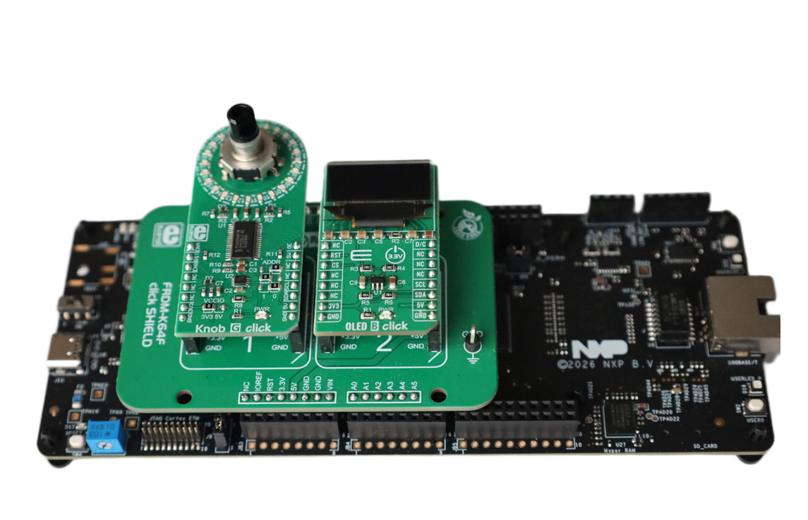
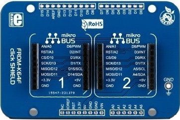
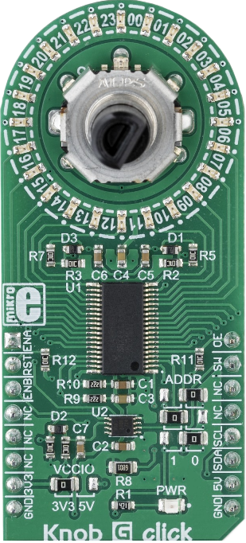
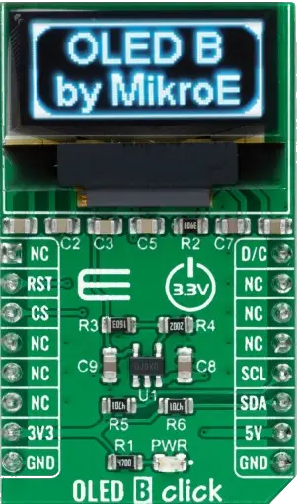
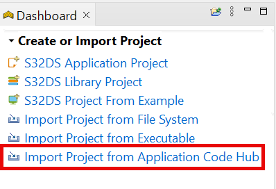
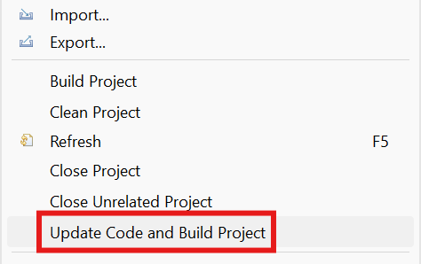
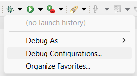
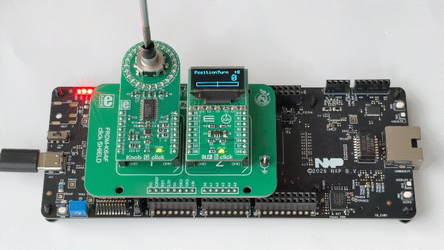

# NXP Application Code Hub

## Rotary Encoder Dashboard with OLED Display and LED Ring
This application reads a rotary encoder on the FRDM-A-S32K358 board and shows its value on an SSD1306 OLED display and on the 24-LED ring of the Knob G click. Two modes can be selected with the SW2 button: **Position mode** (default), a multi-turn relative position from -3600 to +3600 degrees where one click moves one LED (15 degrees), and **RPM mode** (GREEN_LED0 on), a signed value from -2400 to +2400 RPM in steps of 100 per click. The encoder phases are decoded with SIUL2 external interrupts, the OLED is driven over FlexIO I2C and the LED ring over LPI2C using NXP PCA9956B constant current LED driver.
[

](./images/FRDM-A-S32K358_Rotary_Encoder_OLED.png)

#### Boards: FRDM-A-S32K358
#### Categories: Low Power, Sensor, User Interface
#### Peripherals: GPIO, I2C
#### Toolchains: S32 Design Studio IDE

## Table of Contents
1. [Software and Tools](#step1)
2. [Hardware](#step2)
3. [Setup](#step3)
4. [Results](#step4)
5. [Support](#step5)
6. [Release Notes](#step6)

## 1. Software and Tools
This example was developed using the FRDM Automotive Bundle for S32K3 + S32M27. To download and install the complete software and tools ecosystem, use the following link:
- [ FRDM Automotive S32K3 + S32M27 Board Installation Package](https://www.nxp.com/app-autopackagemgr/automotive-software-package-manager:AUTO-SW-PACKAGE-MANAGER?currentTab=0&selectedDevices=S32K3&applicationVersionID=203)

## 2. Hardware
### 2.1 Required Hardware
- Personal Computer
- Type-C USB cable

| Boards | Images |
| ----------- | ------- |
| - [FRDM-A-S32K358](https://www.nxp.com/design/design-center/development-boards-and-designs/FRDM-A-S32K358) |  |
| - [FRDM K64 click shield](https://www.mikroe.com/frdm-k64-click-shield) | 

 |
| - [Knob G click](https://www.mikroe.com/knob-g-click)   - [OLED B click](https://www.mikroe.com/oled-b-click) | 
  
 |

### 2.2 Hardware Connections

| FRDM-A-S32K358   | Header Pin |I/O| FRDM Shield  | Click Board   | Click Pin | Description              |
|------------------|------------|---|--------------|---------------|-----------|--------------------------|
| PTD1  GPIO       | JA4 pin1   | ← | A0           | Knob G Click  | ENA       | Encoder phase A (EIRQ9)  |
| PTB17 GPIO       | JA2 pin5   | ← | D10          | Knob G Click  | ENB       | Encoder phase B (EIRQ31) |
| PTD2  GPIO       | JA1 pin5   | ← | D2           | Knob G Click  | SW        | Encoder Switch (EIRQ10)  |
| GND              | JA3 pin 11 | → | GND          | Knob G Click  | GND       | Ground                   |
| VDD_PERH         | JA3 pin 7  | → | 3.3V         | Knob G Click  | 3V3       | Power Supply             |
| PTA3  GPIO       | JA1 pin 11 | ← | D5           | OLED B Click  | D/C       | I2C Address Selection Pin|
| PTA13 GPIO       | J4 pin 5   | ← | A2           | OLED B Click  | RST       | Reset Pin                |
| PTC10 GPIO       | J2 pin 3   | ← | D9           | OLED B Click  | CS        | Communication Enable Pin |
| PTA14 FlexIO_D14 | J4 pin 11  | → | A4           | OLED B Click  | SDA       | FlexIO I2C SDA Pin       |
| PTE0  FlexIO_D3  | J4 pin 9   | → | A5           | OLED B Click  | SCL       | FlexIO I2C SCL Pin       |
| GND              | JA3 pin 11 | → | GND          | OLED B Click  | GND       | Ground                   |
| VDD_PERH         | JA3 pin 7  | → | 3.3V         | OLED B Click  | 3V3       | Power Supply             |
| PTH1  GPIO       | on-board   | ← | -            | -             | SW2       | Mode select SW2 (EIRQ17) |
| PTG30 GPIO       | on-board   | → | -            | -             | GREEN_LED0| RPM mode indicator       |

### 2.3 Debugger Connection
- Connect the Type-C USB cable to PC and FRDM-A-S32K358 board for power supply and debugging

## 3. Setup

### 3.1 Import the Project into S32 Design Studio IDE
1. Open S32 Design Studio IDE, in the Dashboard Panel, choose **Import project from Application Code Hub**.
[

](./images/import_project_1.png)

2. You can find the demo you need by searching for the name directly. Open the project, click the **GitHub link** from this window, S32 Design Studio IDE will automatically retrieve project attributes then click **Next>**.
[

](./images/import_project_3.png)

3. Select **main** branch and then click **Next>**.
4. Select your local path for the repo in **Destination->Directory** window. The S32 Design Studio IDE will clone the repo into this path, click **Next>**.

5. Select **Import existing Eclipse projects** then click **Next>**.

6. Select the project in this repo (only one project in this repo) then click **Finish**.
### 3.2 Generating, Building and Running the Example
1. In Project Explorer, right-click the project and select **Update Code and Build Project**. This will generate the configuration (Pins, Clocks, Peripherals), update the source code and build the project using the active configuration (e.g. Debug_FLASH).
Make sure the build completes successfully and the *.elf file is generated without errors.
[

](./images/update_and_build.png)
Press **Yes** in the **SDK Component Management** pop-up window to continue.

2. Go to **Debug** and select **Debug Configurations**. There will be a debug configuration for this project:
[

](./images/Debug_config.png)

        Configuration Name                  Description
        -------------------------------     -----------------------
        $(example)_debug_flash_pemicro      Debug the FLASH configuration using PEmicro probe

    Select the desired debug configuration and click on **Debug**. Now the perspective will change to the **Debug Perspective**.
    Use the controls to control the program flow.

## 4. Results
The demo combines a rotary encoder with an SSD1306 OLED display and the Knob G click LED ring to deliver a compact, real-time relative position dashboard:
[

](./images/FRDM-A-S32K358_Rotary_Encoder_OLED_Demo.gif)

- **Encoder input:** both encoder phases (ENA and ENB) generate both-edge interrupts through the SIUL2 external interrupt channels. On every edge the two phase levels are sampled and decoded with a quadrature state table, so the rotation direction is detected reliably.

- **Mode selection:** press **SW2** to switch between Position mode and RPM mode. Position mode is the default after reset. **GREEN_LED0** is on in RPM mode and off in Position mode. Each mode keeps its own value when you switch away and back.

- **Encoder SW button** pressing the the encoder switch resets the value of the active mode to 0.

- **Position mode (default):** the encoder is incremental, so the position is relative to the power-up (or switch-press) zero. One encoder step moves the position by 15 degrees (one LED). Clockwise rotation increases the position and counter-clockwise rotation decreases it. The position is a signed multi-turn value from -3600 to +3600 degrees (10 turns in each direction, 240 clicks) and stops at the limits, like a mechanical axis with end stops.

- **RPM mode:** one encoder step changes the RPM by 100. Clockwise rotation increases the value and counter-clockwise rotation decreases it. The value is limited to the range -2400 to +2400 RPM.

- **Numeric readout:** in Position mode the total signed angle in degrees (-3600 to 3600) is shown as a large number in the middle of the OLED, and the top line shows the number of complete turns (for example `Turn +3` or `Turn -10`). In RPM mode the current RPM value is shown instead.

- **Centered bar graph:** a horizontal gauge below the number has zero in the middle, marked by a tick. Positive values fill to the right of center and negative values fill to the left, reaching the edges at +/-3600 degrees in Position mode and at +/-2400 RPM in RPM mode.

- **LED ring:** the 24 LEDs of the Knob G click follow the active mode. In Position mode exactly one LED is lit, showing the pointer position inside the current turn (angle modulo 360 degrees): LED 0 is at 12 o'clock, LED 6 at 3 o'clock, LED 12 at 6 o'clock and LED 18 at 9 o'clock. In RPM mode the LEDs fill in one direction for positive values (LED 0 up to LED 23) and in the opposite direction for negative values (LED 23 down to LED 0), one LED per click, and all LEDs are off at 0 RPM. If the ring is mounted with LED 0 at a different place, or wired in the opposite direction, adjust `PCA9956B_LED_ZERO_OFFSET` and `PCA9956B_LED_DIRECTION` in `src/pca9956b.h`. The ring is driven by a PCA9956B over LPI2C1 (PTC6 SDA, PTC7 SCL, address 0x15, jumpers JP0=0, JP1=1, JP2=0, JP3=3.3V). The output enable pin OE (active low) is driven by PTA1 and the driver reset shares PTA13 with the OLED reset.

## 5. Support
For general technical questions related to NXP microcontrollers, please use the *NXP Community Forum*.
#### Project Metadata

<!----- Boards ----->

<!----- Categories ----->

<!----- Peripherals ----->

<!----- Toolchains ----->

Questions regarding the content/correctness of this example can be entered as Issues within this GitHub repository.

>**Warning**: For more general technical questions regarding NXP Microcontrollers and the difference in expected functionality, enter your questions on the [NXP Community Forum](https://community.nxp.com/)

## 6. Release Notes
| Version | Description / Update                           | Date                        |
|:-------:|------------------------------------------------|----------------------------:|
| 1.0     | Initial release on Application Code Hub        |November 16th 2026|

